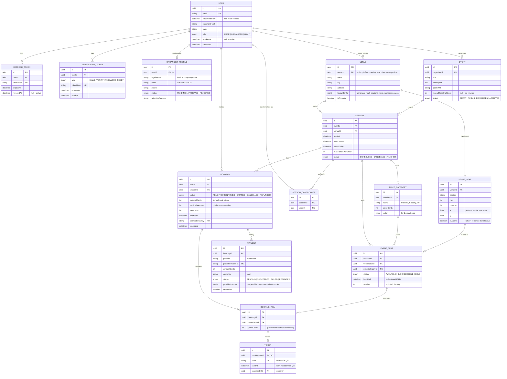

# Database schema

## Key decisions

- **EVENT vs SESSION.** `EVENT` is *what* happens (title, description, poster, refund rules) and is created once. `SESSION` is *where and when* (venue, date, sales period, seats, prices). A tour across 5 cities or a play every Saturday is one event with many sessions. Seats and bookings belong to a session.
- **Price categories.** Organizers price by category ("Parterre — 800 UAH, Balcony — 500 UAH"), not seat by seat. Each `EVENT_SEAT` points to a `PRICE_CATEGORY` of its session.
- **Sales rules on the session**: tickets can be bought only between `salesStartAt` and `salesEndAt`, and no more than `maxTicketsPerOrder` per booking (protection from bots and scalpers).
- **Organizer verification.** Any user can apply to become an organizer with FOP/company details. An admin approves the `ORGANIZER_PROFILE`, and only then the user gets the `ORGANIZER` role.
- **Two kinds of venues.** Platform catalog venues (`ownerId = null`) are created by admins and available to every organizer. If a venue is missing, an organizer creates a private venue (`ownerId = organizer`) that only they can see and use. No venue moderation: organizers are verified instead.
- **Seat layout generator.** A layout is generated from sections and rows (seat count, start number, numbering direction, gaps). Every seat gets `x, y` coordinates, so the frontend draws the map from data, and a visual editor can be added later without changing the model.
- **Blocked seats.** On a specific session the organizer can mark seats as `BLOCKED` (sound desk, cameras, guest seats); they are not sold.
- **VENUE_SEAT vs EVENT_SEAT.** The hall layout is described once (`VENUE_SEAT`). For every session the layout is copied into `EVENT_SEAT`, which holds the price category and the sale status for that session. Later edits to `VENUE_SEAT` affect only new sessions. Seats are deactivated (`isActive = false`), never deleted, and venues with sessions are archived, not deleted.
- **Unique constraint** `(sessionId, venueSeatId)` on `EVENT_SEAT`: one physical seat appears only once per session.
- **BOOKING_ITEM** links a booking to its seats and stores the price at the moment of purchase, so later price changes don't affect old bookings.
- **Temporary hold**: `EVENT_SEAT.status = HELD` + `heldUntil`, `BOOKING.status = PENDING` + `expiresAt`. The payment invoice gets the same validity, and a background job releases expired holds.
- **Platform commission**: `serviceFeeCents` is calculated at booking time and stored, so reports can split organizer revenue and platform income.
- **Payments through a provider interface.** `PAYMENT.provider` is `monobank` now; the code talks to a `PaymentProvider` interface, so another provider (LiqPay, WayForPay) can be added without touching booking logic. A booking can have several payment attempts.
- **Refunds** are allowed until `refundDeadlineHours` before the session starts; a cancelled session refunds all its bookings.
- **Controllers** are users assigned to a specific session (`SESSION_CONTROLLER`). Only they can scan tickets for it; `TICKET.scannedById` records who let the person in.
- **Email verification and password reset** share one token table; only token hashes are stored.
- **Admin controls**: an admin can hide an event (`HIDDEN`) or block a user (`blockedAt`) without deleting data.
- **Rescheduling**: changing a session date keeps tickets valid, notifies buyers and allows a refund regardless of the deadline.
- **JSONB where structure is external or document-like**: `PAYMENT.providerPayload` keeps raw monobank responses for debugging (the bank controls the shape); `VENUE.layoutConfig` keeps the generator input so a layout can be reopened and regenerated.
- **Activity log lives in MongoDB**, not in this schema: append-only events (who did what and when: moderation decisions, price changes, check-ins, booking status changes), each event type with its own fields.
- **Money in kopecks** (`int`) to avoid floating-point errors.
- **Idempotency key** on `BOOKING` prevents duplicate bookings when a client retries the same request.
- Indexes: `SESSION(startsAt)`, `SESSION(eventId)`, `SESSION(venueId)`, `EVENT(status)`, `EVENT_SEAT(sessionId, status)`, `BOOKING(userId)`, `BOOKING(status, expiresAt)`.