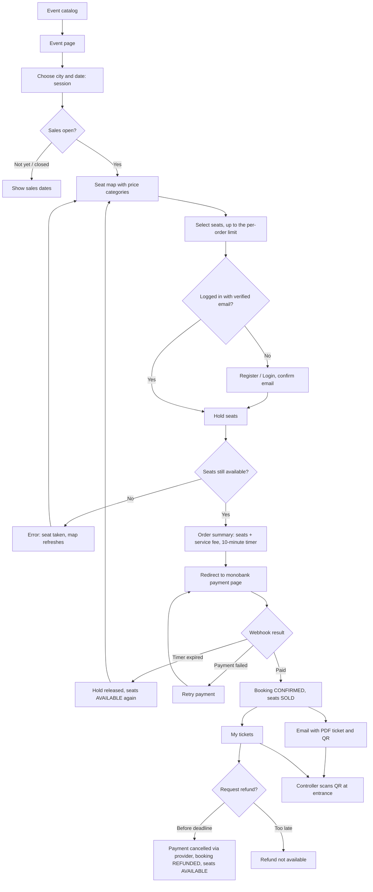
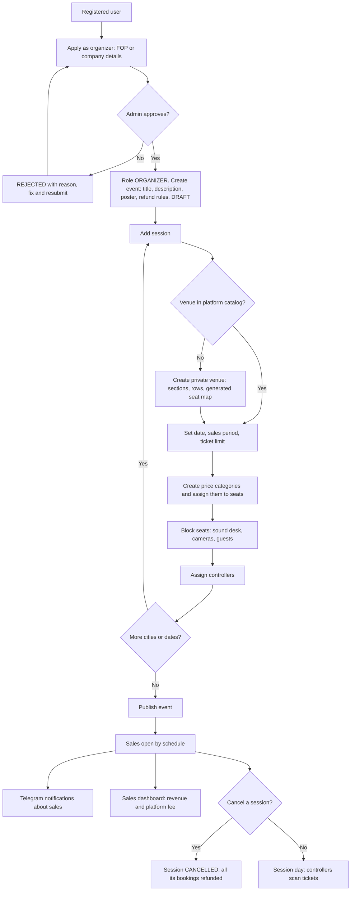
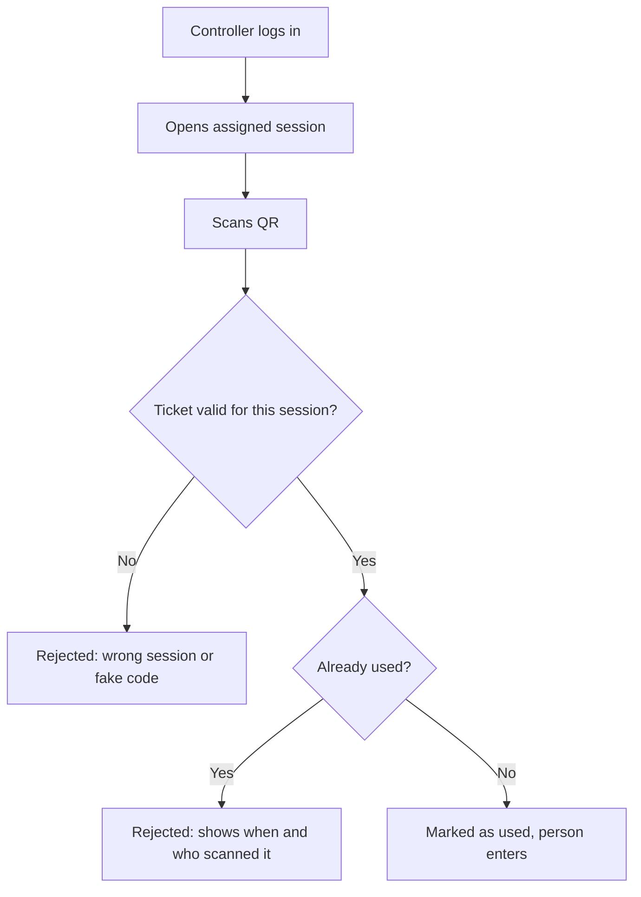
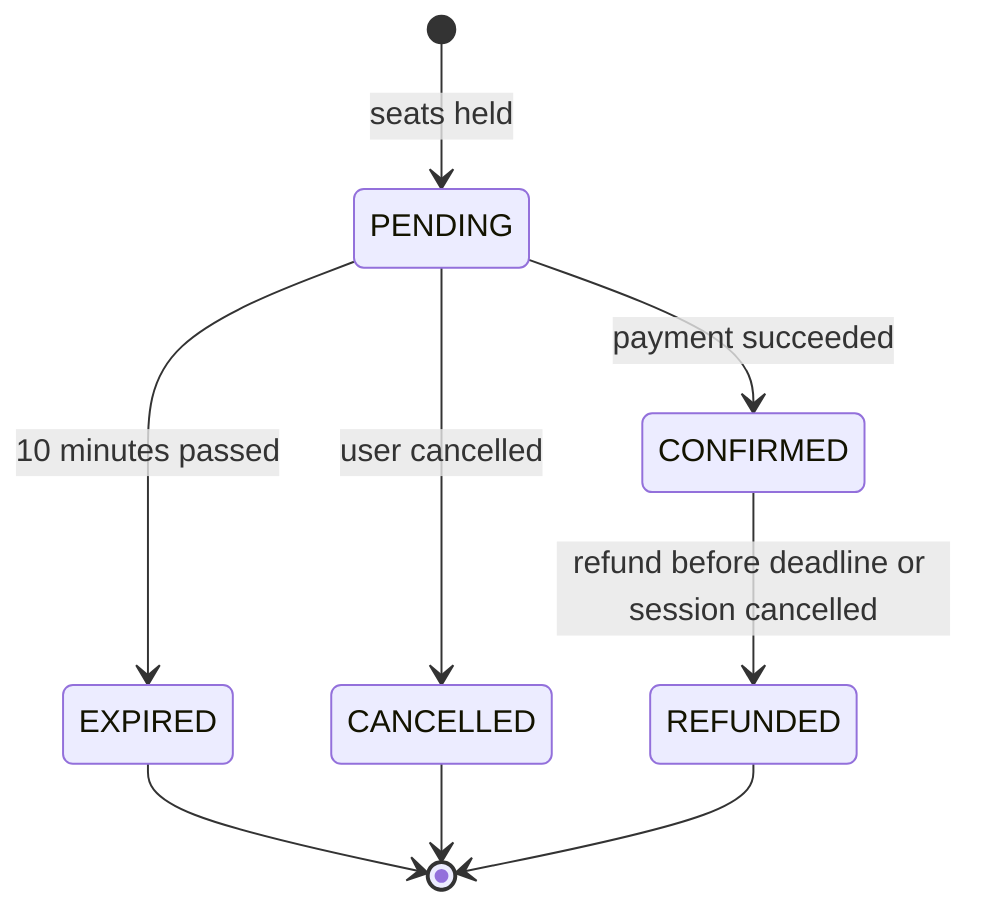
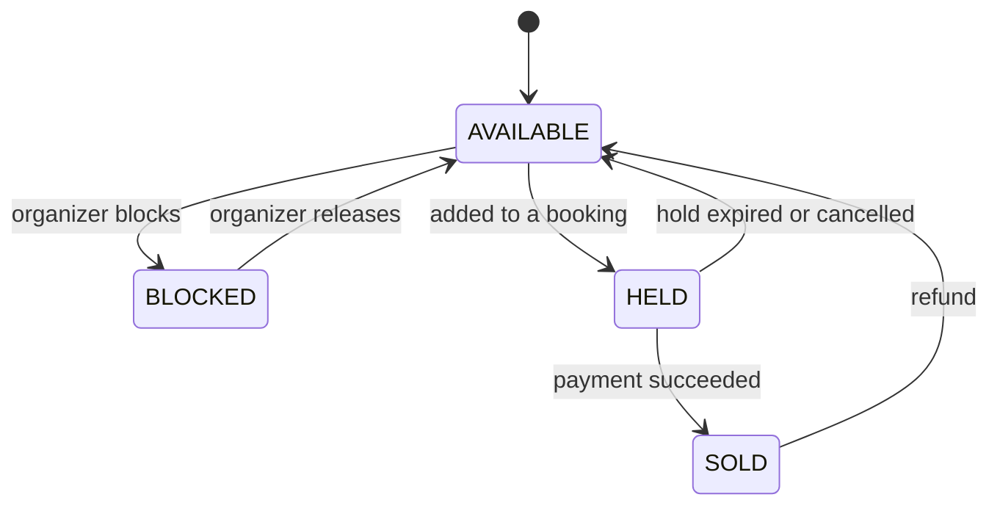
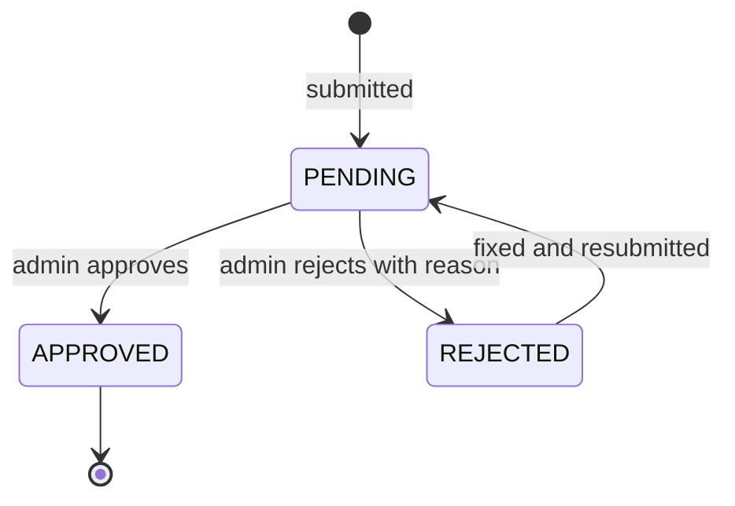

# User flows

## Buyer: from catalog to ticket

## Organizer: from application to check-in

## Controller: check-in

## Booking statuses

## Seat statuses (per session)

## Organizer application statuses

